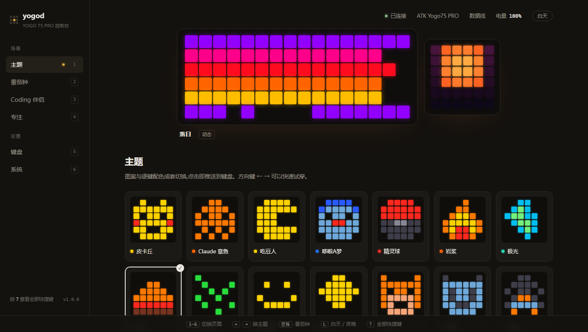
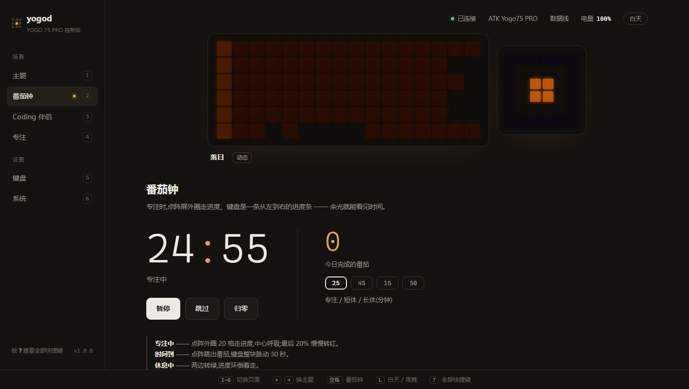
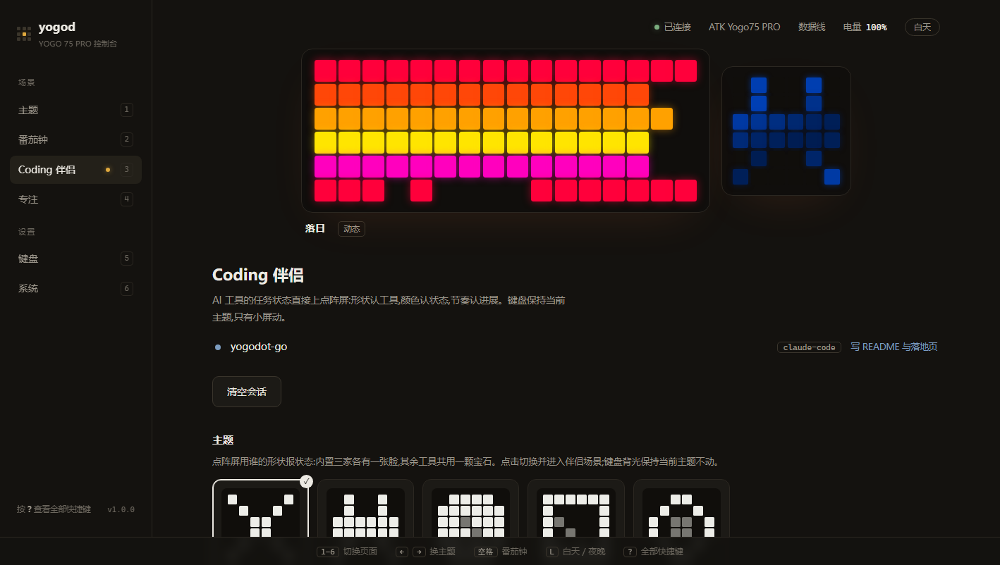
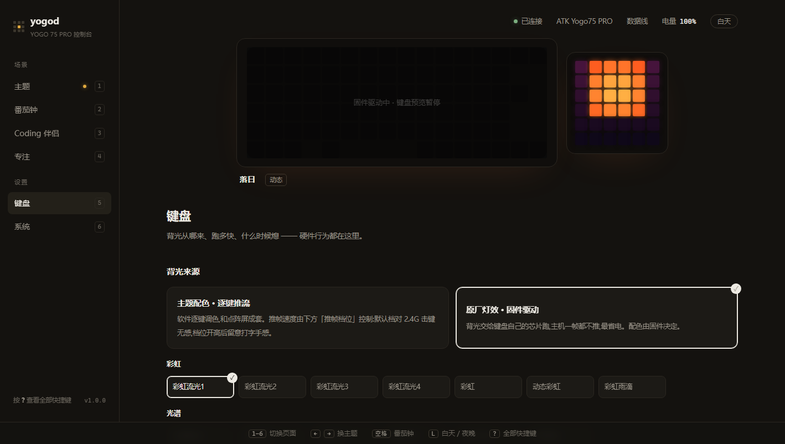
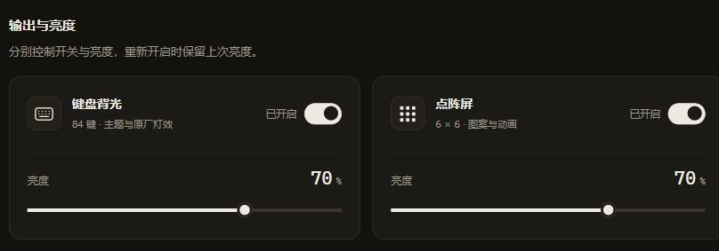

# yogod —— ATK YOGO 75 PRO 点阵屏 / 背光控制（Go 版）

给 **ATK YOGO 75 PRO** 换一套自己的控制台：点阵屏能放 48 张像素图案，28 套主题让背光和小屏
成套变色，Coding 伴侣还会把 AI 工具的工作状态实时摆上键盘。绿色单文件，解压即用，
不碰固件，也用不着官方驱动。

**Windows 免安装 · 免费开源** · [官网](https://juning98.github.io/yogodot_go/) ·
Python 原项目：[yogodot](https://github.com/Wednesque/yogodot)



> **v1.1.0 · 流光自如** — 动画与设备通信解耦，点阵、背光独立开关，输出与亮度界面升级。
> [查看完整更新与实测结果](https://github.com/juning98/yogodot_go/releases/tag/v1.1.0)

## 下载

**[下载最新版 yogod（windows-amd64.zip，约 3 MB）](https://github.com/juning98/yogodot_go/releases/latest)**

| 条件 | 说明 |
|---|---|
| **需要** Windows 10 / 11 | 不用装 Go、Python 或任何运行时 |
| **需要** 键盘用 2.4G 接收器或数据线连接 | |
| **不支持** 蓝牙连接 | 蓝牙模式下键盘的灯控通道不开放，这是固件决定的，任何第三方软件都一样 |

1. 下载 zip，解压到任意文件夹（免安装，单个 exe 内嵌控制台和图标）
2. 双击 `yogod.exe` —— 常驻右下角托盘，自动打开控制台（http://127.0.0.1:25264）
3. 在「主题」页点一套喜欢的，键盘立刻换装；方向键 ← → 可以快速试穿

**首次运行大概率会触发 SmartScreen**（蓝色「Windows 已保护你的电脑」弹窗）：
exe 没有代码签名证书就会这样，并非报毒。展开「更多信息」选「仍要运行」即可，
只会问这一次。

想开机自启：托盘图标右键里勾上即可。数据在 `%LOCALAPPDATA%\yogod`；
想**便携模式**（配置跟着 exe 走）：在 exe 旁边放一个名为 `portable` 的空文件。

## 能做什么

- **28 套主题 / 48 张图案**：皮卡丘、吃豆人、哆啦A梦、初音、EVA、我的世界、DeepSeek 鲸、
  太空侵略者、橡皮鸭、蘑菇…… 逐键配色 + 6×6 点阵成套切换，颜色按这把键盘的灯珠校过，不会发白。
  （24 套逐位移植自原项目，DeepSeek 鲸、太空侵略者、橡皮鸭、蘑菇是 Go 版新增的原生主题。）
- **Coding 伴侣**：AI 编程工具的任务状态直接上点阵屏 —— 形状认工具、颜色认状态、
  节奏认进展（详见下节）。
- **20 个原厂键盘灯效**：背光交给键盘自己的芯片跑，主机一帧不推，最省电。
- **番茄钟 / 专注**：点阵外圈走进度、键盘就是进度条，到点自动切过去提醒；
  专注模式一键全灭，退出恢复原样。
- **独立灯控与省电**：点阵、背光分别开关，关闭后停止该路渲染和推帧；锁屏、空闲自动熄灯，推帧档位三档可调。
- **链路自愈**：键盘休眠、被官方 HUB 抢、有线/2.4G 热切换，都能自己恢复。



## Coding 伴侣

点阵屏用形状报状态，键盘背光保持当前主题不动。内置 Claude Code / Codex / OpenCode
三张脸，其余工具共用一颗宝石兜底 —— **任何客户端接进来就有完整灯语**：

| 状态 | 颜色 | 动效 |
|---|---|---|
| 执行中 | 蓝 | 一道流光扫过形状，各家扫法不同 |
| 等你授权 | 橙 | 双跳心跳，一拍强一拍弱 |
| 等你补充 | 红 | 三连轻叩，一波弱过一波 |
| 完成 | 绿 | 亮一下，光晕从中心荡开，6 秒回空闲 |
| 出错 | 红 | 警示双闪：急两声、长一息，6 秒回空闲 |
| 空闲 | 白 | 慢呼吸，偶尔眨眼，吸气顶到纯白 |



**接入方式**：打开控制台「Coding 伴侣」页，把那段接入指令原样发给你的 AI 工具（推荐），或手动：

```bash
yogod hook events                     # 打印认得的事件名
yogod hook --agent cursor --dry-run   # 拿一段 hook JSON 试翻译
yogod hook install --agent cursor     # 打印要合并进工具配置的片段
```

适配器**通用、不绑厂商**：只认事件名，`--agent` 只是给会话命名的自由字符串。
不在表里的工具照样能接 —— 协议是开放的 `POST /api/events`。

三条硬规则（有测试盯着）：

1. **绝不阻塞工具** —— 超时 350ms、失败重试一次、任何错误吞掉、永远 exit 0
2. **只取白名单元数据** —— prompt / tool_input / 密钥 / 对话正文一律不碰
3. **只连本机** —— hook 命令的外网地址会被拒绝

## 控制台与键盘

控制台是 embed 进二进制的单文件页面，**不参与出帧** —— 关掉页面键盘照常动；
预览是 SSE 推送的真实设备帧（满亮度、无校准，即主题原始颜色）。



「键盘」页的两个关键选择：

- **背光来源**：主题配色（逐键推流，和点阵成套）或原厂灯效（固件驱动，零推帧）。
- **动态 / 静态**：静态 = 点阵和背光都定格，最省电。

推帧档位（默认 6/10、流畅 10/20、极速 15/25 fps）、输入保护、
熄屏策略、灯珠校准（白平衡/饱和/限流，滑杆实时生效）均在「键盘」页；「系统」页显示连接与输出状态。



## 常见问题

**会不会弄坏键盘？**
不会。这个工具只做两件事：往键盘实时推画面、切换背光模式时写一次配置 ——
和官方驱动发给键盘的是同一类指令。固件一个字节都不会动，按键映射也完全不碰。
想让键盘彻底还原，官方 ATK HUB 里有「恢复出厂」。

**要联网吗？**
不需要。从控制台到 hook 再到帧引擎，所有通信都发生在 127.0.0.1 上，
没有任何一个外网请求。

**关掉软件会怎样？**
画面是推过去的，不是烧进去的：退出后键盘保持最后一帧，等它自己睡过去就回到
出厂显示；下次启动软件会重新接管，不用手动补。

**跟 ATK HUB 冲突吗？**
二选一。两边同时写同一把键盘，画面会互相覆盖、谁也显示不稳。
yogod 被抢走后其实能自己夺回来，但日常还是建议只留一个。

**键盘完全没反应了？**
先排查最普遍的三个原因：键盘没电、电源没开、档位停在蓝牙。判断方法很简单 ——
插上线打字，能打说明键盘本身没事，把档位切回 2.4G 即可。
线连着也不亮？翻到下面「键盘不动时先看这两个数」。

**怎么卸载？**
托盘图标右键 → 关掉开机自启 → 退出，然后删掉 exe 所在文件夹和 `%LOCALAPPDATA%\yogod`。

## 已知限制

- 仅支持 Windows；手边只有 YOGO 75 PRO 可测 —— 同厂其他带像素屏的型号协议理论上相近，
  试成了欢迎来 issue 里报个喜
- 蓝牙模式不可控（固件不开放灯控通道）
- 画面靠实时推流维持，软件需要常驻；锁屏和离开会自动熄灯，不用担心耗电

---

下面是给开发者的部分。

## 架构一句话

```
原项目: Chrome 页面里的 JS 定时器 ──HTTP──▶ Python ──HID──▶ 键盘
本仓库: goroutine 帧泵 ────1 槽邮箱────▶ 写设备 goroutine ──HID──▶ 键盘
```

本仓库是 [yogodot](https://github.com/Wednesque/yogodot)（Python + 浏览器页面引擎）的
Go 重写：把原项目藏在 Chrome 窗口里的 JS 动画引擎搬进进程内，用 goroutine 帧泵直接驱动键盘。
主题、图案、调色板、动画曲线全部逐位对拍移植 —— 原项目 24 套主题在 Go 侧的颜色输出
与原 JS 逐字节一致（见「测试」一节的对拍说明）。

## 命令行

```bash
yogod probe                 # 列出 HID 接口并握手一次
yogod status                # 连接、电量、配置回读
yogod theme                 # 列出全部主题
yogod theme pikachu         # 推一套过去（单次执行，不常驻）
yogod run                   # 前台跑引擎（Ctrl+C 退出）
yogod bench                 # 推帧压测（开发用）
yogod serve                 # 日常使用，双击等效
yogod serve 127.0.0.1:9000  # 临时换端口
```

双击启动不弹黑窗（`-H windowsgui`）；从终端敲子命令，输出会接回父终端。

端口固定 25264，被占用会直接报错而不是顺延 —— 端口一换，hook 和页面都得跟着找，
反而更难排查。确需换端口：

```powershell
$env:YOGO_PORT='8899'; yogod serve
```

数据目录是 `%LOCALAPPDATA%\yogod`（不会往下载目录里撒配置文件）。
目录里会出现：`yogod.ico`（托盘图标）、`yogod.log`（运行日志，排查「键盘不动」用）、
`console.addr`（正在运行的控制台地址）、`settings.json`。

## HTTP 接口

```
GET  /api/ping             健康检查
GET  /api/state            全量状态（场景/主题/电量/番茄钟/会话/输出应用状态）
GET  /api/themes           28 套主题（含 6×6 字符画）
GET  /api/patterns         48 张图案，按 6 组
GET  /api/agents           伴侣内置工具形状
POST /api/scene            {id}                  切场景（theme/pomodoro/companion/focus）
POST /api/theme            {id, dynamic}         切主题
POST /api/pattern          {id}                  图案单选（空串还原）
POST /api/brightness       {dot, keys}           亮度（只压设备，不压预览）
POST /api/keyboard         {id}                  原厂灯效（-1 = 主题配色）
POST /api/pomodoro         {action, preset?}     start/pause/skip/reset
POST /api/events           伴侣标准事件（GET = SSE 帧与状态流）
GET  /api/sessions         会话列表
POST /api/sessions         清会话
GET/POST /api/settings     配置（输出开关/校准/熄屏/推帧档位/输入保护/空闲形状）
```

`/kb/*` 保留了一套兼容层（`status` / `power` / `readcfg` / `config` / `dotmode` /
`matrix` / `keys` / `stopkeys` / `reconnect`），给老脚本用。`/kb/lightbuf` 和
`/kb/anim` 返回 `ok:false` —— VIA 灯效缓冲区和"页面塞帧序列"没有移植，动画由引擎驱动。

## 输出状态与省资源

控制台「键盘」页分别控制点阵、背光开关，关闭一路后停止该路渲染和推帧。
两路独立关闭时各写一次全黑帧，随后停止该路渲染和推帧；软件动画恢复时直接发送当前画面。
保留底层推流模式，避免固件重新提交共享配置时闪回其它图案。这里是灯光熄灭，不声称硬件断电。
原厂背光效果关闭时也用黑帧临时接管，恢复时只退出逐键推流，继续原厂效果。

静态通道只渲染一次，成功发送后内容不变就不再发送。动态图像按两路独立期限限速，
只保留最新目标；失败不会更新成功基线，重试退避一秒。连接恢复后重放当前目标。
常驻帧数、丢帧分类和统计看门狗已经移除，资源调度不依赖这些计数。

`/api/state.output` 区分设置已保存与设备已应用：`pending` 表示等待设备应用，
`error` 是当前应用错误。`device` 提供连接、应答、电量和最近链路错误；这些是状态而非累计统计。

## 构建

```bash
go build -trimpath -ldflags="-s -w -H windowsgui" -o yogod.exe ./cmd/yogod
```

发版用 `build.cmd`：构建 exe + 收文档 + 打成 `dist\yogod-v<版本>-windows-amd64.zip`（免安装，解开即用，
沿用原项目的发布约定；约 3 MB）。

**零第三方依赖**，只用标准库 + `syscall`/`unsafe` 直调 setupapi / hid / user32 /
shell32。不需要 cgo、hidapi、WebView2。编译产物约 7 MB 单文件（其中约 4 MB 是
`net/http` 带进来的 TLS 栈 —— 本地服务用不到，但 Go 无法只编译 HTTP/1，可接受）。

## 安全护栏

- `reset_device`（cmd 49）在原版协议表里夹在常用号段中间，原项目只在注释里写"千万别发"。
  本版把它从白名单里物理移除，`proto.Packet.Marshal` 直接拒绝（有测试断言发不出去）。
- 没有 Claude 额度 / 凭据读取：原项目的 `quota` / `.credentials.json` 整个不移植。
- 伴侣适配器只取白名单元数据，喂一个带 prompt、密钥、正文的 payload 进去，
  断言发出去的 JSON 里一个敏感字节都找不到。

## 测试

```bash
go vet ./...
go test ./... -skip "TestLive|TestReadTimeout"
```

几个值得单独说的：

- **`internal/color` 与 `internal/theme` 是对拍的，不是手算的。**
  `testdata/gen_color_fixtures.js` 和 `gen_theme_fixtures.js` 会**真的执行原项目
  `yogo.html` 里的原始 JS**，生成期望值；Go 侧搬错一个字符、一个色值、
  一个动画参数就会红。
- **`internal/engine` 的核心断言**：写设备慢 100ms 时帧泵仍按节拍推进 ——
  对应原项目"跑久了就卡死"的老 bug。
- **`internal/api` 盯"沉默降级"**：`TestConsoleFieldContract` 把页面读的字段和
  服务端真发的 JSON 绑在一起，改任一边都会红。
- **`internal/hid` / `internal/device` 有真机集成测试**：上面的离线命令跳过它们。单独验收设备时先退出常驻程序，再显式运行真机测试。
- 伴侣有状态机测试（心跳/叩门/绽放的节奏曲线）和"不许泄漏正文"测试。

## 两条关键设计

### 1. 渲染只读内存，时钟与 IO 解耦

场景按实际经过时间产出逻辑颜色，公共管线统一做亮度、校准和编码。
预览使用原色，直接读取渲染快照；设备慢不会阻塞预览。电量轮询在后台执行并发布状态。
静态通道与关闭的通道不重复渲染，双路静态时停止动画定时器。修改亮度和校准不重置动画相位。

最新目标通过单个快照交给发送循环。所有 HID 操作（整帧分包、读改写配置、电量、重连）
通过同一个设备工作循环串行执行，避免分包交错。SSE 为每位订阅者分别保留最新状态和最新画面。

### 2. 设备模式以回读为准

首次接管或切换底层灯效模式时写入并回读确认，完成后才发送对应画面。写入变化的配置分段后，
补发配置区末尾一段提交修改（这把键盘的真机行为）。日常开关不写配置、不结束点阵同步；
真正提交配置后，两路显示都重新应用当前目标，避免固件重绘后静态画面没有恢复。
正常运行每 60 秒只读检查配置漂移，结合 HID 拓扑变化恢复链路；
恢复不重新进入场景，不重置动画时钟。全灭期间不主动做配置对账。

设置先完整校验；落盘等待不占用快照锁，保存失败返回错误，页面收到成功后才显示「已保存」。
伴侣会话在事件写入和后台过期清理时生成快照，渲染只读优先会话。

## 移植时踩过的坑（留给后来人）

**1. 24 套主题的 `Theme.KB` 字符画字段全是空的。**
原版没有一套主题把键盘配色写成字符画 —— 全是 `kbDiamond(...)` / `kbFlow(...)`
这样的构图函数调用。按"字符画"去读会推出一块全黑的键盘，**不报错、不 panic**。
`KBFrames()` 在字符画为空时退回构图函数的第一帧，`TestNoThemeRendersBlank` 守住这条。

**2. 三处"看起来等价"的浮点写法会让颜色差 1–2。**

| 原 JS | 天真翻译 | 后果 |
|---|---|---|
| `(((x % 1) + 1) % 1)` | `x - math.Floor(x)` | `+1` 再 `%1` 动最低位，`2.4999…9` 与 `2.5` 分道扬镳 |
| `c * 255 / mx` | `c * (255 / mx)` | 先算倒数得 `195.4999…97`，精确算得 `195.5`，round 后差 1 |
| `(h*60 + deg + 360) % 360` | `mod(h*60+deg, 360)` | 那次 `+360` 挪一个 ulp，级联到整块键盘 |

**3. `ANIMS.fire` 不是 `f(t)`。** 每帧调 `Math.random()`、且 `fireBuf` 跨帧演化，
既随机又有状态，无法像素级对拍。算法逐行照抄，
`TestFireWarmup` 锁定"火苗一帧往上爬一格"的特征（点亮格数 6→12→18→24→30→36）。

**4. 108 字节切 5 包，最后一包只有 12 字节有效。**
Python 的 `ljust` 顺手补了零，照抄成 Go 切片直接 panic
（`slice bounds out of range [:120] with length 108`）。现在分包是纯函数，有单测。

## 目录

```
cmd/yogod/            命令行入口与装配（serve 的依赖注入都在这里）
internal/proto/       报文与配置字节布局（纯函数，零依赖）
internal/color/       灯珠调色：ledize / 增益 / 饱和度 / EQL / RGB565
internal/frame/       点阵帧(108B) 与逐键帧(168B) 的编码
internal/hid/         Windows HID：SetupAPI 枚举 + overlapped 读写
internal/device/      串行设备事务、整帧写入、配置回读、电量、原厂灯效表
internal/engine/      帧泵、Scene 接口、独立输出调度、预览快照
internal/theme/       调色板、构图原语、24 套移植主题 + 4 套原生、48 张图案
internal/store/       settings.json（单一来源、原子写、可迁移）
internal/agent/       伴侣事件的状态机
internal/companion/   hook 适配器（通用、白名单、只连本机、绝不阻塞）
internal/api/         HTTP + SSE + /kb/* 兼容层 + 嵌入式控制台
internal/sys/         空闲 / 锁屏 / 托盘 / 自启 / 单实例 / Job Object
testdata/             对拍数据生成脚本与产物
docs/design/          控制台设计稿与截图工具（shot.mjs）
docs/img/             README / 官网配图（真机控制台截图）
```

## 致谢

原项目 [yogodot](https://github.com/Wednesque/yogodot)（Python）—— 主题、图案、
调色管线和全部动画曲线的来源。Go 版用 fixture 对拍保证移植不失真。

## 许可

MIT。像素图里的角色形象版权归各自所有者，仓库不包含任何官方素材。
个人项目，与 ATK、Anthropic、DeepSeek 都没有关系，风险自负。
