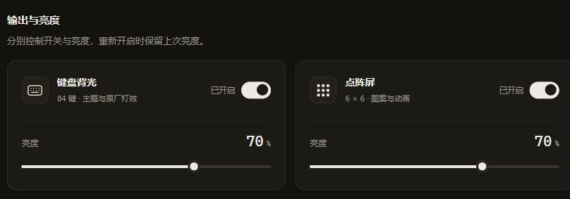

# ✨ yogod v1.1.0 · 流光自如

**更流畅的动画，更独立的灯光，更清晰的控制。**

v1.1.0 围绕每天都能感受到的体验升级：动画持续流动，点阵与背光各自掌控，开关与亮度一目了然。

## 🌊 动画流畅，预览从容

- **修复预览周期性停顿**：电量查询在后台执行，画面渲染只读取内存状态，设备通信不再挡住预览。
- **动画保持连续**：按真实经过的时间推进，调整亮度、校准以及设备恢复时保持动画相位。
- **公共链路统一升级**：覆盖全部 28 套主题，Coding 伴侣与番茄钟也使用同一套渲染、亮度和输出管线。

## 🎛️ 两路灯光，各自掌控

- **点阵与背光独立开关**：日常开关保留当前设备模式，避免重新提交共享配置带来的串图与恢复黑等。
- **关掉，就停止刷新**：对应通道写入一次全黑帧后，停止该路渲染和推帧；重新开启时恢复当前画面与原有亮度。
- **静态画面按需发送**：成功写入后才更新去重基线，相同画面不重复发送；两路各自限速与重试。
- **自动熄灯继续生效**：保留锁屏、键鼠空闲与低电量策略，检测到输入后按当前设置恢复。

## 🎨 控制面板，焕然一新

**键盘背光在左，点阵屏在右。** 每一路都有自己的图标、状态开关、亮度读数与滑杆。

- 滑动式开关清楚显示「已开启 / 已关闭」。
- 亮度以百分比呈现，滑杆填充实时跟随数值。
- 支持深色、浅色与窄屏布局，支持键盘焦点、空格切换和方向键调光。
- 设置成功保存后再提示「已保存」，保存失败会显示具体错误。

## 🧪 真机验证，看得见的改进

本轮使用 **ATK YOGO 75 PRO · 2.4G · DeepSeek 鲸动态主题**验证：

| 验证项目 | 结果 |
| :-- | :-- |
| 点阵、背光各三轮独立开关 | 实物确认没有串图、另一通道不受影响、恢复没有黑等 |
| 12 次开关请求完成时间 | 60～131 ms |
| 两路持续关闭超过一分钟 | 实物确认保持全灭，没有自行亮起 |
| 连续 125 秒键盘预览采样 | 帧间隔中位数 100.0 ms，P99 101.6 ms，最大 116.2 ms |
| 刷新控制台后的观察 | 没有再出现周期性卡顿 |

预览数据为本机 SSE 接收间隔，预览按约 10 fps 推送。代码改动覆盖公共链路；本轮实物验收聚焦主题动画，原厂背光效果恢复未单独做实物验收。

软件验证通过：13 个包的回归测试、设备 / 引擎 / API / 配置 / 伴侣状态 / 程序装配的竞态检查、`go vet`，以及控制台保存反馈、请求顺序和交互检查。

🛠️ 引擎与通信更新

- 渲染、预览与设备 IO 分离，发送循环始终使用最新目标。
- 整帧分包、配置读改写、电量查询和重连统一通过设备工作循环串行执行。
- 首次接管和底层模式变化后回读设备配置，区分「设置已接受」与「设备已应用」。
- 移除常驻帧数、丢帧分类及统计看门狗，资源控制由独立调度、成功帧去重和失败退避承担。
- 配置快照与磁盘写入分离；伴侣状态提前生成快照，渲染无需等待后台整理。
- SSE 分别保留最新状态与最新画面，慢订阅者不会积压历史帧。
- 修复同一路径设备重连时旧读循环失效的问题。

## 📦 下载与升级

**Windows 10 / 11 · 64 位 · 免安装 · 零第三方运行时依赖**

👉 [下载 yogod-v1.1.0-windows-amd64.zip](https://github.com/juning98/yogodot_go/releases/download/v1.1.0/yogod-v1.1.0-windows-amd64.zip)

1. 在托盘菜单退出旧版 yogod。
2. 解压下载包，用新的 `yogod.exe` 替换原文件。
3. 双击运行；已有控制台页面刷新一次即可。

现有主题、亮度、校准和熄屏设置会保留；便携模式请保留原目录中的 `portable` 和 `settings.json`。从旧版升级时，新增的两路输出开关默认开启。

支持 USB 数据线与 2.4G 接收器；蓝牙模式不开放灯控通道。安装包 SHA-256 见同页附件 `SHA256SUMS.txt`。

---

[完整变更](https://github.com/juning98/yogodot_go/compare/v1.0.4...v1.1.0) · [使用文档](https://github.com/juning98/yogodot_go#readme) · [项目官网](https://juning98.github.io/yogodot_go/)
